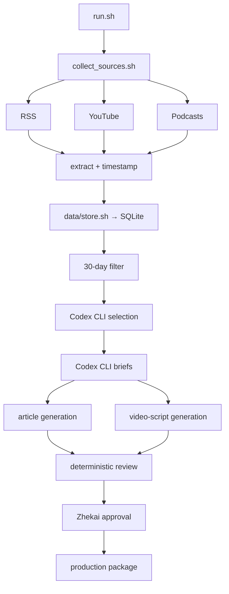

# Problem Set 4 Student Submission

This completed document is the entry point for the implementation, retained evidence, review record, and publication links. The course instructions remain unchanged in [README.md](README.md), and the required contracts remain in [ARCHITECTURE.md](ARCHITECTURE.md).

**Student:** Zhekai Li
**GitHub repository:** https://github.com/Zhekai-Li/ps04

## Topic and Audience

- **Publication name:** *Scholar in the Loop*
- **Topic:** Responsible uses of AI in research topic selection and academic writing.
- **Audience and assumed knowledge:** PhD students in artificial intelligence and operations research who already use LLM tools and understand research design, literature review, and academic publication.
- **Central question:** Which uses of AI in research topic selection and academic writing improve efficiency without weakening originality, evidentiary rigor, author responsibility, or scholarly value?
- **Scope and exclusions:** Includes topic discovery, research-gap evaluation, outlining, drafting, revision, citation verification, and disclosure. Excludes undergraduate cheating, generic workplace productivity, automated paper generation, fabricated citations, and unsupervised acceptance of AI conclusions.
- **Reason for readers to return:** Each edition re-evaluates practical workflows against new empirical evidence, policy changes, tool behavior, and researcher experience rather than assuming that an efficiency claim remains valid.

## Published Series

All publication links below were verified after publication.

| Piece | Title | Substack article | YouTube video |
| --- | --- | --- | --- |
| 1 | Use AI to Expand the Search Space, Not Choose the Research Bet | [Article](https://zhekaili.substack.com/p/use-ai-to-expand-the-search-space) | [Unlisted video](https://youtu.be/mcfW1UkP8_M) |
| 2 | Fluent Reasoning Is Not Provenance: Build a Verification Layer | [Article](https://zhekaili.substack.com/p/fluent-reasoning-is-not-provenance) | [Unlisted video](https://youtu.be/8ZhAS-fPmHw) |
| 3 | Preserve Responsibility by Recording the Research Process | [Article](https://zhekaili.substack.com/p/preserve-responsibility-by-recording) | [Unlisted video](https://youtu.be/xrAhfqGbpZM) |

## Technical Demonstrations

Both technical-demo versions are retained and linked for reviewers:

| Version | Access | Duration | Role |
| --- | --- | --- | --- |
| AI-narrated full demonstration | [Unlisted YouTube video](https://youtu.be/-XfGao1GRJs) · [eight-slide deck](runs/live-20261010T142614Z-b7aaa14e/package/technical_demo/technical-demo-final.pptx) | 5:57 | **Formal course submission.** It satisfies the required 4–6 minute duration and covers every required demonstration element. The Nyla AI voiceover is disclosed. |
| Human-narrated full demonstration | [Repository MP4](runs/live-20261010T142614Z-b7aaa14e/package/technical_demo/technical-demo-human-narrated.mp4) · [eight-slide source deck](runs/live-20261010T142614Z-b7aaa14e/package/technical_demo/technical-demo-final.pptx) | 7:24 | **Supplementary reviewer version.** Zhekai Li personally narrates the full demonstration. It is intentionally presented as additional evidence because it exceeds the formal 4–6 minute limit. |

The shared narration/content reference is [`docs/technical_demo_script.md`](docs/technical_demo_script.md). An unused [five-slide alternate recording deck](runs/live-20261010T142614Z-b7aaa14e/package/technical_demo/technical-demo-human-recording.pptx) and its [preview](runs/live-20261010T142614Z-b7aaa14e/package/technical_demo/technical-demo-human-recording-thumbnails.jpg) are also retained, but the uploaded human MP4 visibly uses the full eight-slide deck. The course contract requires a narrated demonstration but does not require the student's face, personal voice, or a manually captured screen recording. Reviewers can therefore use the compliant AI-narrated version as the formal submission and the human-narrated version as supplementary confirmation of the student's understanding.

The three articles and their accompanying videos were published after the evidence-grounded live runs, personal review, Google Vids production, and design QA. Final signed-out access and reciprocal-link verification are recorded as part of the publication handoff. On October 12, 2026, all four YouTube uploads were also confirmed to have completed 1920×1080 processing. A downloaded 1080p frame from the first audience video matched its local final source at SSIM 0.9983; a blurry Auto playback session should be switched to 1080p rather than treated as a damaged upload.

## Final Submission Status

| Course requirement | Final evidence | Status |
| --- | --- | --- |
| RSS, YouTube, and podcast inputs; at least 12 eligible items, six publishers, and two items per input type | Final summary records 46 eligible items from 10 publishers: 24 feed, 15 YouTube, and 7 podcast items | Complete |
| Sixteen independently runnable Bash component boundaries | Required files in `run.sh`, `workflows/`, `collectors/`, `processing/`, `data/`, `editorial/`, `content/`, `review/`, `publishing/`, and `reporting/` | Complete |
| Three connected evidence-grounded arguments | [`briefs.jsonl`](runs/live-20261010T142614Z-b7aaa14e/briefs.jsonl), with feed, YouTube, and podcast evidence represented | Complete |
| Human review of at least three accepted and three rejected/deferred decisions, followed by a policy revision | [`docs/editorial_review.md`](docs/editorial_review.md) and policy versions 2 and 3 in the retained runs | Complete |
| Two complete live runs on different days, duplicate handling, and explicit failure/recovery evidence | October 9 and October 10 runs listed below; failed run retained separately | Complete |
| Three 600–900 word Substack articles and three matching 3–5 minute Google Vids videos | Published links above; final measured article and video lengths are retained in `review.json` and `video_drafts.json` | Complete |
| Reciprocal article/video links, source references, shareable free articles, and Unlisted videos | `publication_links.json`, published posts, and YouTube descriptions | Complete |
| Separate 4–6 minute technical demonstration | Formal Unlisted 5:57 AI-narrated video linked above; supplementary 7:24 human-narrated version retained alongside it | Complete |
| Submission documentation, architecture, setup, evidence locations, and reflection | This document and linked guides | Complete |

There is no remaining required production or publication action. The repository-level command `python3 scripts/audit_submission.py` checks the final requirement evidence, publication state, course-file hashes, English-only tracked text, claim IDs, local documentation links, and required component permissions.

## Setup and Execution

Required local tools are Python 3.12, Bash, SQLite, `jq`, Git, `ffmpeg`, and `shellcheck`. The pinned Python dependencies are in `requirements.txt`.

```bash
bash scripts/setup.sh
bash scripts/check_backends.sh
```

The default pipeline uses an authenticated local Codex CLI with JSON Schema output for the four text stages. The snapshotted model is `gpt-5.6-sol` at high reasoning effort. Missing media transcripts are produced locally with `mlx-whisper==0.4.3` and `mlx-community/whisper-turbo`, including word timestamps. This path uses ChatGPT-plan allowance and local compute, so the final run records zero incremental API cost while leaving Codex's per-run dollar cost unknown rather than reporting a false `$0` model price. Paid API fallback is disabled unless `PS04_ALLOW_PAID_FALLBACK=1` is explicitly set for that run. Resolved backends, models, usage, revision information, and costs are recorded in receipts. See [`docs/account_setup.md`](docs/account_setup.md) for account steps. No credential belongs in this repository.

Before each live run, audit `config/sources.json` for current access, relevance, publisher identity, and enough redundancy to yield at least 12 eligible items from six publishers. Topic settings live in `config/project.json`; selection rules in `config/editorial_policy.md`; and stage instructions in `prompts/`. Every run snapshots these files.

The required entry commands are:

```bash
bash run.sh
bash run.sh --package runs/live-20261010T142614Z-b7aaa14e
```

The second command reproduces the approved package without recollecting sources or regenerating content. For a future run, replace the final run path with the new run directory only after completing its matching human approval.

```bash
# independent stages
bash collectors/fetch_feeds.sh runs/RUN_ID
bash collectors/fetch_youtube.sh runs/RUN_ID
bash collectors/fetch_podcasts.sh runs/RUN_ID
bash processing/extract_content.sh runs/RUN_ID < runs/RUN_ID/candidates.jsonl
bash data/store.sh init
bash data/store.sh upsert runs/RUN_ID < runs/RUN_ID/items.jsonl
bash data/store.sh list
bash data/store.sh get ITEM_ID VERSION_ID

# labeled repeatability demonstrations
bash scripts/replay_run.sh runs/LIVE_RUN_ID
bash scripts/replay_run.sh runs/LIVE_RUN_ID path/to/withheld-candidates.jsonl
bash scripts/demonstrate_failure.sh youtube

# verification
.venv/bin/pytest -q
shellcheck -x run.sh workflows/*.sh collectors/*.sh processing/*.sh data/store.sh \
  editorial/*.sh content/*.sh review/*.sh publishing/*.sh reporting/*.sh \
  scripts/*.sh scripts/lib/*.sh
python3 scripts/audit_submission.py
```

## Architecture and Manual Handoffs



The 16 required Bash files are public component boundaries. Focused modules under `src/` implement schemas, collectors, extraction, SQLite persistence, model calls, content generation, checking, packaging, and reporting. Only `data/store.sh` accesses `data/evidence/evidence.db`; all historical lookups go through its interface. Exact source text and transcript segments live in `data/assets/`. Full design and schema explanations are in [`docs/LEARNING_GUIDE.md`](docs/LEARNING_GUIDE.md).

For inspection, start with human-readable filenames rather than searching opaque IDs manually: (1) read this document; (2) open [`docs/editorial_review.md`](docs/editorial_review.md); (3) open the final run’s [`summary.json`](runs/live-20261010T142614Z-b7aaa14e/summary.json); (4) inspect `briefs.jsonl`, `decisions.jsonl`, and `review.json` in that same run; (5) read `package/articles/`, `package/video_scripts/`, and `package/source_notes/`; and (6) follow a source-note item/version ID into `data/assets/` only when checking the exact evidence. The hexadecimal names are stable content identities used for auditability, not files that a reviewer is expected to discover by guessing.

The automated run ends at `awaiting_review`. Zhekai reviews `decisions.jsonl`, `briefs.jsonl`, the three articles, three scripts, exact evidence, and `review.json`; records corrections; and personally creates `approval.json` matching the current `review_id`. The system refuses missing, stale, or non-approving decisions. Packaging copies the reviewed work and generates per-piece source notes plus `package/PRODUCTION.md`.

The manual handoff used `package/video_scripts/*.md` to build three reviewed 3–5 minute Google Vids exports. Final MP4 metadata is recorded in `package/video_drafts.json`; final design QA is in `package/video_qc_v4/final/`. `package/articles/*.md` supplied the free Substack posts and `package/source_notes/*.md` supplied viewer-facing attribution. All four YouTube uploads are Unlisted, each audience video description includes its article and source references, each article links back to its video, and the three article/video URLs are recorded in `package/publication_links.json`. Media omitted from Git can be recovered using [`docs/media_retrieval.md`](docs/media_retrieval.md).

## Evidence and Runs

Link to the retained evidence, editorial decisions, briefs, content checks, and intermediate artifacts needed to inspect the complete workflow. Keep referenced text and transcript files accessible. Explain how to retrieve media omitted from the repository.

| Run | Actual date | Run artifacts and logs | Elapsed time | Approximate cost |
| --- | --- | --- | --- | --- |
| First complete live run | 2026-10-09 UTC | [`runs/live-20261009T183914Z-438d5dc4`](runs/live-20261009T183914Z-438d5dc4) | 608 seconds | `$0` incremental API cost; Codex covered by ChatGPT plan |
| Day-two discovery and policy-validation run | 2026-10-10 UTC | [`runs/live-20261010T141700Z-ca069018`](runs/live-20261010T141700Z-ca069018) | 481 seconds | `$0` incremental API cost; Codex covered by ChatGPT plan |
| Corrected second live run | 2026-10-10 UTC | [`runs/live-20261010T142614Z-b7aaa14e`](runs/live-20261010T142614Z-b7aaa14e) | 2,880 seconds, including local long-audio transcription | `$0` incremental API cost; Codex covered by ChatGPT plan and transcription run locally |

The complete runs retain `run.json`, `candidates.jsonl`, `items.jsonl`, `changes.jsonl`, `eligible.jsonl`, `exclusions.jsonl`, `decisions.jsonl`, `briefs.jsonl`, drafts/scripts, `review.json`, `summary.json`, and `logs/`. The October 9 run recorded 3 new and 47 unchanged versions. The first October 10 run then discovered one new eligible Latent Space podcast, “Why AlphaFold Didn't Solve Protein Folding,” accepted it as bounded expert testimony, and used it in the verification argument. The corrected October 10 rerun recorded that podcast and all other 43 observations as unchanged, showing that repeated collection did not create unnecessary versions or redo the local transcript. The earlier failed run [`runs/live-20261009T173953Z-701a3aa8`](runs/live-20261009T173953Z-701a3aa8) remains intact: it records two long-podcast transcription failures and the invalid uppercase claim ID `01-C1`. The final run demonstrates recovery with local MLX transcription and the strict lower-case claim schema.

Automated contract evidence in `tests/` verifies ordered store replay behavior and historical retrieval, unchanged retrieval timestamps, inclusive date boundaries and all exclusion reasons, empty success versus simulated failure, strict-output retry behavior, claim resolution, review fingerprints, approval staleness, and link preservation. These fixtures do not count as live evidence; the retained October 9 and October 10 runs above supply the required live evidence.

Published-claim trace: piece 3 marker `03-c4` → [`briefs.jsonl`](runs/live-20261010T142614Z-b7aaa14e/briefs.jsonl) → the accepted, bounded SciSpace testimonial decision in [`decisions.jsonl`](runs/live-20261010T142614Z-b7aaa14e/decisions.jsonl) → item `youtube:q_g-rU1kW2o`, version `1972602e5362635f440c0256b31d08016785947e9d7ac2657fc4405cfe1dd3a2` → transcript segments `yt-00022` through `yt-00027` at 00:51–01:11 → [`package/source_notes/03.md`](runs/live-20261010T142614Z-b7aaa14e/package/source_notes/03.md) → matching article and video statements. The trace retains only the qualitative division-of-labor testimony and excludes the unsupported quantitative time-saving claim.

## Editorial Review

Current policy: [`config/editorial_policy.md`](config/editorial_policy.md). Prompts: [`prompts/select_items.md`](prompts/select_items.md), [`prompts/create_briefs.md`](prompts/create_briefs.md), [`prompts/write_articles.md`](prompts/write_articles.md), and [`prompts/write_video_scripts.md`](prompts/write_video_scripts.md). Each actual run retains its exact copies under `runs/RUN_ID/config/` and `runs/RUN_ID/prompts/`.

Zhekai's comparison of three accepted and three rejected/deferred decisions is complete in [`docs/editorial_review.md`](docs/editorial_review.md). The record includes exact item/version identifiers, evidence paths, personal judgments, and the resulting policy change.

The pre-revision policy remains immutable at [`runs/live-20261009T183914Z-438d5dc4/config/editorial_policy.md`](runs/live-20261009T183914Z-438d5dc4/config/editorial_policy.md). Policy version 3 is [`config/editorial_policy.md`](config/editorial_policy.md). It changed the SciSpace medical-doctor testimonial from rejection to bounded acceptance for pieces 2 and 3 while excluding its unsupported efficiency comparison. Final automated review is [`review.json`](runs/live-20261010T142614Z-b7aaa14e/review.json); Zhekai's matching human approval is [`approval.json`](runs/live-20261010T142614Z-b7aaa14e/approval.json).

## Reflection

The strongest evidence-based insight is that AI's most defensible role is not autonomous scholarly judgment but inspectable expansion, verification, and process recording: broaden candidate directions, trace claims and dependencies, and preserve correction lineage while the researcher retains the research bet and final evidentiary decisions.

The observed editorial limitation was claim-level contamination at item level. The original selection correctly distrusted an unsupported vendor efficiency comparison but rejected the entire testimonial, losing a relevant qualitative account of human–AI task boundaries. Human review separated those evidentiary roles, and policy version 3 made the distinction repeatable.

The next improvement would move this separation earlier by assigning claim-level evidence roles and incentive labels during extraction, before item-level selection. That would make it harder for one weak quantitative assertion to suppress a separately useful qualitative passage and would make later brief construction more precise.

The implemented architectural tradeoff is already clear: small Bash entry points and JSONL streams make every stage easy to replay, inspect, and demonstrate, but process boundaries provide less compile-time safety than one Python application. Typed Pydantic validation, deterministic hashes, immutable run snapshots, receipts, and a single storage owner mitigate that cost while preserving the assignment’s independently runnable interfaces.
